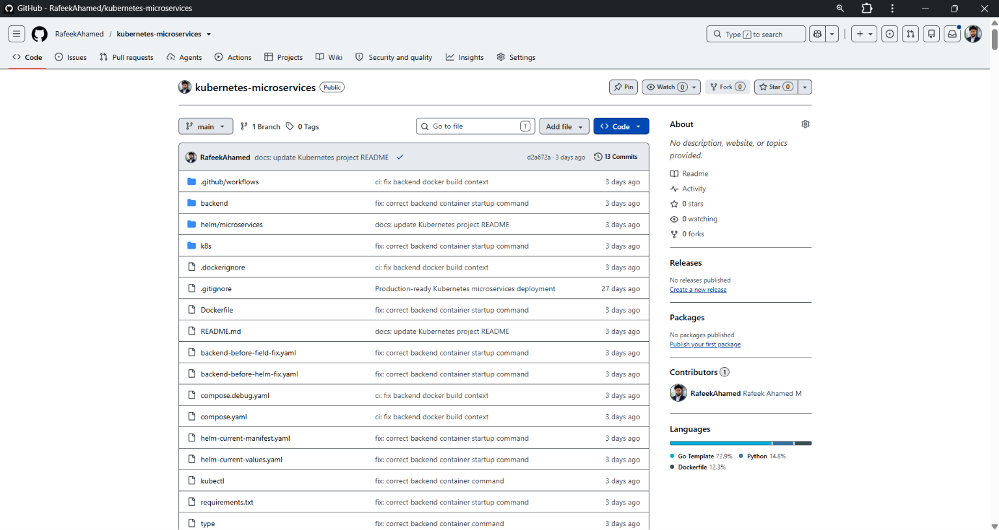
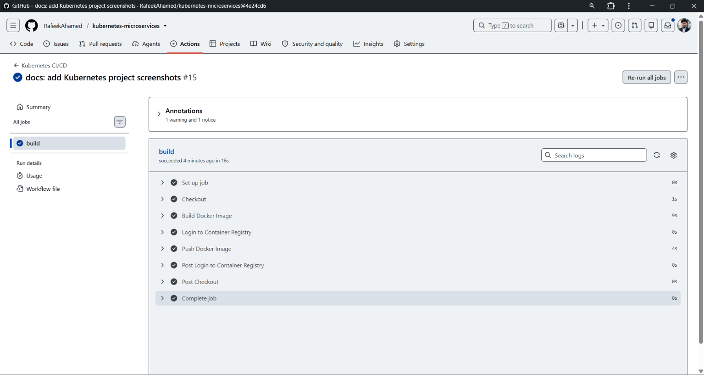
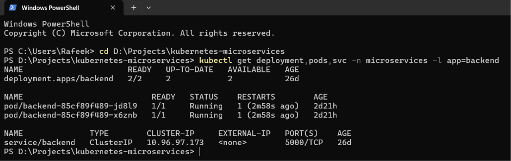
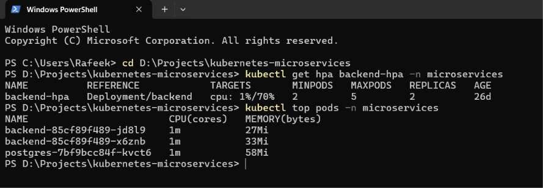
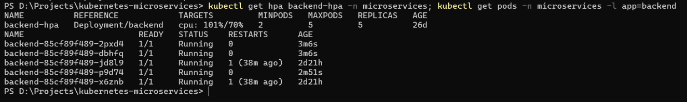
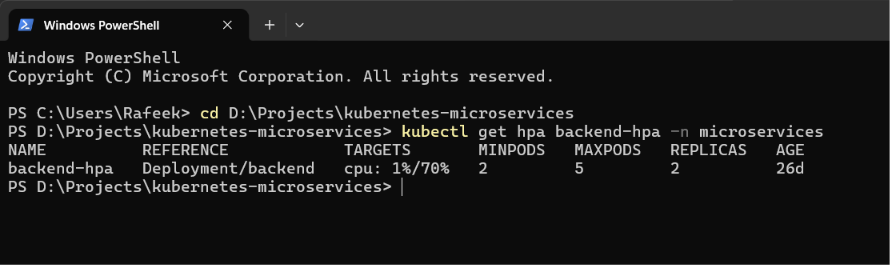
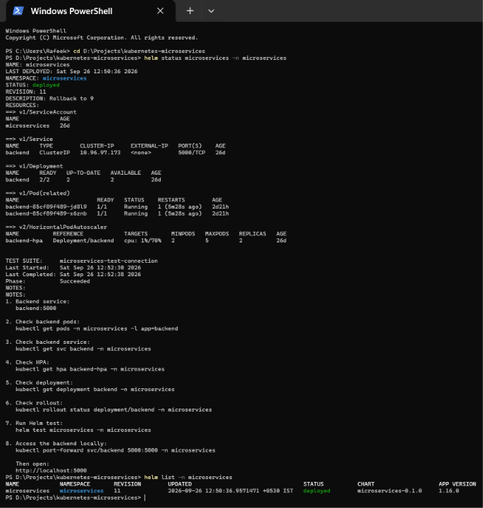
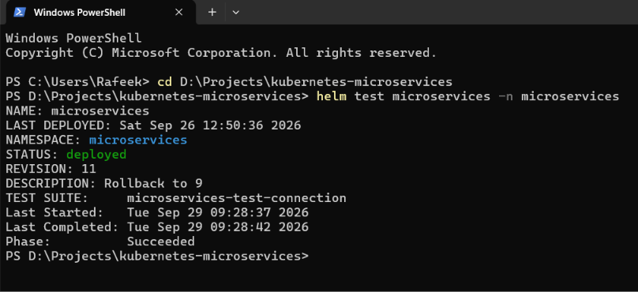
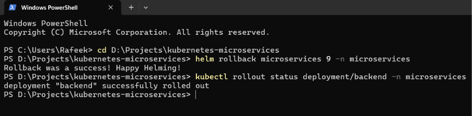

# Kubernetes Microservices Deployment & CI/CD

A hands-on DevOps project demonstrating containerization, Kubernetes orchestration, Helm release management, GitHub Actions CI automation, autoscaling configuration, RBAC, health monitoring and deployment troubleshooting.

The project uses a **local Kubernetes environment with Docker Desktop** and focuses on practical Kubernetes operations without Azure or AKS.

## Project Overview

This project demonstrates how to build and publish a containerized Flask backend, deploy it to Kubernetes, manage application releases using Helm, configure horizontal pod autoscaling and troubleshoot workload and cluster-level issues.

### Key Features

* Docker-based backend containerization
* Kubernetes Deployments, Services and Namespaces
* Helm charts and release management
* GitHub Actions image build and publishing workflow
* Docker Hub image registry integration
* PostgreSQL deployment and internal service discovery
* ConfigMaps and Kubernetes Secrets
* Readiness and liveness probes
* CPU and memory requests and limits
* Horizontal Pod Autoscaling (HPA)
* ServiceAccounts and RBAC
* Kubernetes Ingress configuration
* Rolling updates and rollout history
* Helm upgrades, tests and rollback
* Kubernetes logs, events and metrics-based troubleshooting

---

## Architecture

### CI Image Publishing Workflow

```text
Developer
    |
    | Git Push
    v
GitHub Repository
    |
    v
GitHub Actions
    |
    | Build Docker Image
    | Authenticate with Docker Hub
    | Tag with Git Commit SHA
    v
Docker Hub
    |
    v
Versioned Backend Image
    |
    | Selected for Kubernetes deployment
    v
Docker Desktop Kubernetes
```

### Kubernetes Application Architecture

```text
                 Kubernetes Cluster
                  microservices NS
                         |
          +--------------+--------------+
          |              |              |
          v              v              v
      Ingress       Backend HPA      PostgreSQL
          |          CPU 70%         Deployment
          |          Min: 2              |
          |          Max: 5              v
          v              |          PostgreSQL
      Backend             |          Service :5432
      Service             |
      ClusterIP           |
      :5000                |
          |                |
          v                v
       Backend Deployment
       2 or more replicas
          |
          v
       Flask API
```

**Important:** GitHub Actions currently handles image building and publishing. Kubernetes deployment is managed separately through Helm or standalone Kubernetes manifests.

---

## Technology Stack

| Technology     | Purpose                                     |
| -------------- | ------------------------------------------- |
| Kubernetes     | Container orchestration                     |
| Docker         | Application containerization                |
| Helm           | Kubernetes packaging and release management |
| GitHub Actions | CI automation                               |
| Docker Hub     | Container image registry                    |
| Python / Flask | Backend API                                 |
| PostgreSQL     | Relational database                         |
| YAML           | Kubernetes and CI/CD configuration          |
| Git / GitHub   | Source control                              |
| kubectl        | Kubernetes administration                   |
| PowerShell     | Local administration and troubleshooting    |
| Linux          | Container runtime environment               |

---

## Project Structure

```text
kubernetes-microservices/
│
├── .github/
│   └── workflows/
│       └── ci-cd.yml
│
├── backend/
│   └── app.py
│
├── frontend/
│
├── helm/
│   └── microservices/
│       ├── Chart.yaml
│       ├── values.yaml
│       ├── deployment.yaml
│       ├── charts/
│       └── templates/
│           ├── deployment.yaml
│           ├── service.yaml
│           ├── hpa.yaml
│           ├── ingress.yaml
│           ├── httproute.yaml
│           ├── serviceaccount.yaml
│           ├── _helpers.tpl
│           ├── NOTES.txt
│           └── tests/
│               └── test-connection.yaml
│
├── k8s/
│   ├── backend-deployment.yaml
│   ├── backend-service.yaml
│   ├── configmap.yaml
│   ├── hpa.yaml
│   ├── ingress.yaml
│   ├── postgres-deployment.yaml
│   ├── postgres-service.yaml
│   └── rbac.yaml
│
├── screenshots/
│
├── Dockerfile
├── requirements.txt
├── compose.yaml
├── compose.debug.yaml
├── .dockerignore
├── .gitignore
└── README.md
```

The backend Dockerfile is located at the repository root.

---

## Docker Containerization

### Build the backend image

Run from the repository root:

```powershell
docker build -t backend:test .
```

### Run the container

```powershell
docker run --rm -p 5000:5000 backend:test
```

### Test the application

```powershell
curl.exe http://localhost:5000
```

The Dockerfile runs the application using a non-root user:

```dockerfile
USER appuser
```

The application starts with:

```dockerfile
CMD ["python", "backend/app.py"]
```

---

## Kubernetes Environment

The project uses a local Docker Desktop Kubernetes cluster.

Verified environment:

| Component            | Version / Configuration |
| -------------------- | ----------------------- |
| Kubernetes context   | docker-desktop          |
| Kubernetes version   | v1.36.1                 |
| Node                 | desktop-control-plane   |
| Operating system     | Debian GNU/Linux 13     |
| Kernel               | WSL2 Linux kernel       |
| Container runtime    | containerd 2.3.1        |
| Kubernetes namespace | microservices           |

Check the current context:

```powershell
kubectl config current-context
```

Check cluster nodes:

```powershell
kubectl get nodes -o wide
```

Create the application namespace if it does not exist:

```powershell
kubectl create namespace microservices
```

Verify:

```powershell
kubectl get namespace microservices
```

---

## Kubernetes Deployment Using Standalone Manifests

The `k8s/` directory contains standalone Kubernetes resources for the backend, PostgreSQL, ConfigMap, HPA, Ingress and RBAC.

Create the namespace:

```powershell
kubectl create namespace microservices
```

Apply the standalone manifests:

```powershell
kubectl apply -f k8s/ -n microservices
```

The PostgreSQL deployment expects the `postgres-secret` Secret to exist in the same namespace. Create that Secret separately before applying the PostgreSQL workload. Do not commit real credentials to GitHub.

Verify resources:

```powershell
kubectl get all -n microservices
```

Inspect configuration and access-control resources:

```powershell
kubectl get configmap,secret -n microservices
kubectl get serviceaccount,role,rolebinding -n microservices
```

**Deployment method note:** The standalone manifests and Helm chart both manage backend Kubernetes resources. They are alternative deployment methods. Do not apply both over the same resources without understanding the ownership and configuration differences.

---

## Helm Deployment

The project includes a Helm chart for managing the backend application release.

### Validate the chart

```powershell
helm lint .\helm\microservices
```

Verified result:

```text
1 chart(s) linted, 0 chart(s) failed
```

### Render Kubernetes templates

```powershell
helm template microservices .\helm\microservices --namespace microservices
```

This renders the chart resources without installing them.

### Install the release

```powershell
helm install microservices .\helm\microservices -n microservices --create-namespace
```

### Check release status

```powershell
helm status microservices -n microservices
```

### List releases

```powershell
helm list -n microservices
```

### Inspect release history

```powershell
helm history microservices -n microservices
```

### Important Helm chart scope

The current chart renders:

* Backend Deployment
* Backend ClusterIP Service
* Horizontal Pod Autoscaler
* ServiceAccount
* Helm test connection Pod

The chart expects the `app-config` ConfigMap to exist. PostgreSQL, the PostgreSQL Secret and the standalone Ingress are not deployed by the current default Helm configuration.

The chart contains optional Ingress and HTTPRoute templates, but both features are disabled in the current values.

---

## Backend Deployment

The Helm-managed backend Deployment uses the following configuration:

| Setting            | Value         |
| ------------------ | ------------- |
| Application        | Flask backend |
| Container port     | 5000          |
| Initial replicas   | 2             |
| Service type       | ClusterIP     |
| CPU request        | 100m          |
| Memory request     | 128Mi         |
| CPU limit          | 500m          |
| Memory limit       | 512Mi         |
| Readiness endpoint | `/health`     |
| Liveness endpoint  | `/health`     |

Check the Deployment:

```powershell
kubectl get deployment backend -n microservices
```

Check backend Pods:

```powershell
kubectl get pods -n microservices -l app=backend
```

Inspect the Deployment:

```powershell
kubectl describe deployment backend -n microservices
```

---

## Kubernetes Service

The backend is exposed internally using a ClusterIP Service.

| Setting                 | Value     |
| ----------------------- | --------- |
| Service name            | backend   |
| Service type            | ClusterIP |
| Service port            | 5000      |
| Target application port | 5000      |

Check the Service:

```powershell
kubectl get svc backend -n microservices
```

Other workloads in the namespace can access the backend using:

```text
http://backend:5000
```

---

## Health Checks

The backend Deployment defines readiness and liveness probes.

```yaml
readinessProbe:
  httpGet:
    path: /health
    port: 5000

livenessProbe:
  httpGet:
    path: /health
    port: 5000
```

**Readiness probe:** Determines whether the application is ready to receive traffic.

**Liveness probe:** Helps Kubernetes identify an unhealthy application container and restart it when the configured failure conditions are met.

Inspect Pod health:

```powershell
kubectl describe pods -n microservices
```

View application logs:

```powershell
kubectl logs -n microservices -l app=backend
```

---

## Resource Management

The backend uses Kubernetes resource requests and limits.

```yaml
resources:
  requests:
    cpu: "100m"
    memory: "128Mi"
  limits:
    cpu: "500m"
    memory: "512Mi"
```

Requests help Kubernetes schedule workloads based on available resources. Limits constrain the resources available to containers.

---

## Horizontal Pod Autoscaling

The backend uses the Kubernetes `autoscaling/v2` API.

| Setting                | Configuration |
| ---------------------- | ------------: |
| Minimum replicas       |             2 |
| Maximum replicas       |             5 |
| CPU utilization target |           70% |

Check HPA configuration:

```powershell
kubectl get hpa -n microservices
```

Check resource metrics:

```powershell
kubectl top pods -n microservices
```

Check node metrics:

```powershell
kubectl top nodes
```

### Verified HPA state

A live cluster check returned:

```text
NAME          REFERENCE            TARGETS       MINPODS   MAXPODS   REPLICAS
backend-hpa   Deployment/backend   cpu: 1%/70%   2         5         2
```

This confirms that the HPA is configured for a minimum of two and a maximum of five replicas. The observed two-replica state is consistent with the configured minimum.

---

## RBAC

The project includes Kubernetes Role-Based Access Control resources.

The standalone RBAC manifest defines:

* ServiceAccount
* Role
* RoleBinding

The `pod-reader` Role grants the configured pod-reading permissions, and the RoleBinding associates those permissions with its ServiceAccount.

Inspect RBAC resources:

```powershell
kubectl get serviceaccount -n microservices
kubectl get role -n microservices
kubectl get rolebinding -n microservices
```

---

## ConfigMaps and Secrets

The standalone Kubernetes configuration includes an `app-config` ConfigMap.

It supplies application configuration such as:

```text
APP_ENV=production
DB_HOST=postgres
DB_PORT=5432
```

Inspect ConfigMaps:

```powershell
kubectl get configmap -n microservices
```

Inspect Secret names and metadata:

```powershell
kubectl get secrets -n microservices
```

The PostgreSQL deployment uses a Kubernetes Secret named `postgres-secret` for database environment variables.

**Security:** Never commit passwords, API keys, access tokens or other credentials to source control. Keep sensitive values outside the repository and use an appropriate secret-management approach.

---

## Ingress

The standalone Kubernetes manifests include an NGINX Ingress resource.

Configured hostname:

```text
microservices.local
```

The Ingress manifest routes application requests to the backend Service on port 5000.

Check the Ingress:

```powershell
kubectl get ingress -n microservices
```

The Ingress resource exists in the verified cluster. However, its reported address was empty during verification, so external or hostname-based reachability has not been confirmed.

---

## PostgreSQL

The standalone Kubernetes manifests include:

* PostgreSQL Deployment
* PostgreSQL ClusterIP Service
* Secret-based database environment configuration

The database Service exposes port:

```text
5432
```

Check PostgreSQL resources:

```powershell
kubectl get deployment,service,pods -n microservices
```

The verified PostgreSQL Pod was Running and Ready.

**Storage limitation:** No PersistentVolumeClaim was present in the `microservices` namespace during verification. Therefore, the current PostgreSQL deployment does not demonstrate persistent-volume-backed database storage or durable recovery across Pod replacement.

---

## Rolling Updates and Rollout Management

Kubernetes Deployments support rolling updates to replace Pods progressively.

Check rollout status:

```powershell
kubectl rollout status deployment/backend -n microservices
```

View rollout history:

```powershell
kubectl rollout history deployment/backend -n microservices
```

Restart the Deployment when required:

```powershell
kubectl rollout restart deployment/backend -n microservices
```

---

## Helm Upgrade and Rollback

Helm provides release history and rollback functionality.

View release history:

```powershell
helm history microservices -n microservices
```

Upgrade the release:

```powershell
helm upgrade microservices .\helm\microservices -n microservices
```

Rollback to a selected revision:

```powershell
helm rollback microservices 9 -n microservices
```

Check release status:

```powershell
helm status microservices -n microservices
```

### Verified rollback exercise

A deliberate invalid-image test was used to exercise Helm rollback and recovery.

The recorded rollback result was:

```text
STATUS:      deployed
REVISION:    11
DESCRIPTION: Rollback to 9
```

The known-good backend image was:

```text
rafeekahamed/backend:47ee97acd74492bd34209a6374f640a56676a3aa
```

The verified backend Deployment returned to two available replicas after rollback.

Check the active image:

```powershell
kubectl get deployment backend -n microservices -o jsonpath="{.spec.template.spec.containers[0].image}"
```

Check rollout status:

```powershell
kubectl rollout status deployment/backend -n microservices
```

---

## Helm Test

The Helm chart includes a test hook for backend Service connectivity.

Run:

```powershell
helm test microservices -n microservices
```

Verified result:

```text
TEST SUITE: microservices-test-connection
Phase: Succeeded
```

The test Pod completed successfully.

---

## CI/CD with GitHub Actions

The workflow is located at:

```text
.github/workflows/ci-cd.yml
```

The workflow automates backend Docker image building and publishing.

### Workflow

```text
Git Push
   |
   v
Checkout Repository
   |
   v
Build Docker Image
   |
   v
Authenticate with Docker Hub
   |
   v
Tag Image with Git Commit SHA
   |
   v
Push Image to Docker Hub
```

The published image follows this naming convention:

```text
rafeekahamed/backend:<commit-sha>
```

Example verified image:

```text
rafeekahamed/backend:47ee97acd74492bd34209a6374f640a56676a3aa
```

### CI/CD scope

The current GitHub Actions workflow builds and pushes the backend image. It does not automatically deploy the application to Kubernetes.

Kubernetes deployment and release management are handled separately using Helm or standalone Kubernetes manifests.

### GitHub Actions secrets

The workflow uses repository secrets for Docker Hub authentication:

```text
REGISTRY_URL
REGISTRY_USERNAME
REGISTRY_PASSWORD
```

The registry password should be a Docker Hub access token.

Never hardcode registry credentials in workflow YAML or commit them to GitHub.

---

## Kubernetes Troubleshooting

The project includes practical troubleshooting using `kubectl`, Helm, container logs, Kubernetes events and resource metrics.

### Inspect Pods

```powershell
kubectl get pods -n microservices
```

### Inspect Deployments

```powershell
kubectl get deployments -n microservices
```

### Inspect Services

```powershell
kubectl get services -n microservices
```

### View application logs

```powershell
kubectl logs <pod-name> -n microservices
```

### View previous container logs

```powershell
kubectl logs <pod-name> -n microservices --previous
```

### Follow logs

```powershell
kubectl logs -f <pod-name> -n microservices
```

### Describe a Pod

```powershell
kubectl describe pod <pod-name> -n microservices
```

### Inspect HPA

```powershell
kubectl get hpa -n microservices
```

### Inspect resource metrics

```powershell
kubectl top pods -n microservices
kubectl top nodes
```

### Inspect Kubernetes events

```powershell
kubectl get events -n microservices --sort-by=.lastTimestamp
```

### Inspect Helm release

```powershell
helm status microservices -n microservices
helm history microservices -n microservices
```

---

## Cluster-Level Troubleshooting Exercise

A cluster-wide disruption was investigated using Kubernetes diagnostics.

The investigation included:

* Node condition and readiness inspection
* Control-plane Pod inspection
* Container restart count analysis
* Previous container logs
* Kubernetes event analysis
* Kubernetes API Service and endpoint verification
* Metrics Server and HPA verification
* Local-path provisioner troubleshooting

### Observations

During the incident:

* Multiple workloads across different namespaces experienced restarts or health-probe failures.
* The API server and etcd Pods were recreated.
* The local-path provisioner reported a Kubernetes API connection timeout to `10.96.0.1:443`.
* Metrics Server became temporarily unavailable, affecting HPA metric retrieval.
* The application and supporting workloads subsequently recovered.

The evidence was consistent with a temporary Kubernetes control-plane or networking interruption in the Docker Desktop environment. The exact initiating cause was not established.

### Recovery verification

The following checks subsequently confirmed recovery:

```powershell
kubectl get nodes -o wide
kubectl get pods -n kube-system
kubectl get pods -n microservices
kubectl get hpa -n microservices
kubectl top pods -n microservices
```

This exercise demonstrates troubleshooting across application, Kubernetes networking, control-plane, metrics and supporting infrastructure layers.

---

## Verified Project Results

| Capability                        | Verification                        |
| --------------------------------- | ----------------------------------- |
| Docker image build                | Demonstrated                        |
| Docker Hub image publishing       | Demonstrated                        |
| GitHub Actions CI workflow        | Implemented                         |
| Kubernetes backend Deployment     | Running                             |
| Backend ClusterIP Service         | Verified                            |
| PostgreSQL Deployment and Service | Running                             |
| Helm chart lint                   | Passed                              |
| Helm template rendering           | Passed                              |
| Helm release management           | Verified                            |
| Helm rollback                     | Verified                            |
| Helm test hook                    | Succeeded                           |
| Readiness and liveness probes     | Configured                          |
| Resource requests and limits      | Configured                          |
| HPA configuration                 | Verified                            |
| HPA metrics retrieval             | Working after recovery              |
| RBAC resources                    | Present                             |
| Ingress resource                  | Present; reachability not confirmed |
| Persistent PostgreSQL storage     | Not configured                      |
| Cluster-level troubleshooting     | Demonstrated                        |

---

## DevOps and Kubernetes Skills Demonstrated

### Kubernetes

* Pods and ReplicaSets
* Deployments
* Services and service discovery
* Namespaces
* ConfigMaps and Secrets
* ServiceAccounts and RBAC
* Ingress
* Readiness and liveness probes
* Resource requests and limits
* Horizontal Pod Autoscaling
* Rolling updates
* Rollback and recovery
* Kubernetes events and troubleshooting

### Helm

* Chart structure
* `Chart.yaml` and `values.yaml`
* Kubernetes templates
* Chart linting
* Template rendering
* Release installation
* Release history
* Upgrade and rollback
* Helm test hooks

### Docker

* Dockerfile development
* Image building
* Non-root container execution
* Container testing
* Docker Hub publishing
* Git SHA-based image tagging

### CI/CD

* GitHub Actions
* Automated image builds
* Registry authentication
* Versioned image publishing
* Git-based workflow automation

### Troubleshooting

* `kubectl logs`
* Previous container logs
* `kubectl describe`
* Kubernetes events
* Resource metrics
* HPA metric troubleshooting
* Pod restart investigation
* API Service and endpoint verification
* Helm release troubleshooting

---

## Project Screenshots

The following screenshots provide visual evidence of the repository, CI workflow, Kubernetes deployment, HPA configuration and Helm release operations.

### GitHub Repository



### GitHub Actions



### Kubernetes Deployment



### HPA — Normal State



### HPA — Scale Up



### HPA — Scale Down



### Helm Release Status



### Helm Test



### Helm Rollback



### Backend Application Validation


---

## Resume and Portfolio Highlights

**Kubernetes Microservices Deployment & CI/CD**

* Containerized a Flask backend using Docker and deployed it to Kubernetes using Deployments, Services, ConfigMaps, Secrets and health probes.
* Created a reusable Helm chart for backend deployment, HPA configuration, ServiceAccount management and release lifecycle operations.
* Configured CPU-based Horizontal Pod Autoscaling with a 70% utilization target and a replica range of two to five.
* Automated Docker image building and Docker Hub publishing through GitHub Actions using Git commit SHA-based image tags.
* Implemented Kubernetes RBAC, Ingress configuration, rolling updates and Helm rollback workflows.
* Performed Helm chart validation, template rendering, release testing and rollback recovery.
* Investigated Kubernetes workload restarts, API connectivity timeouts, metrics availability and cluster-level events using `kubectl` and Helm.

---

## Project Outcomes

```text
Docker Containerization
         |
         v
GitHub Actions CI
         |
         v
Docker Hub Image Publishing
         |
         v
Kubernetes Deployment
         |
         v
Service Discovery
         |
         v
Health Monitoring
         |
         v
HPA Configuration
         |
         v
Helm Release Management
         |
         v
Rollback and Troubleshooting
```

---

## Author

**Rafeek Ahamed M**

DevOps Engineer | Azure Cloud Engineer

* GitHub: https://github.com/RafeekAhamed
* LinkedIn: https://linkedin.com/in/rafeek-ahamed-devops
* Portfolio: https://rafeek.rafeekahamed046.workers.dev/

---

## Project Focus

**Kubernetes • Docker • Helm • GitHub Actions • CI/CD • HPA • RBAC • Ingress • PostgreSQL • Linux • YAML**
